# sochandoff

[](https://github.com/ARUSHUGAL/sochandoff/actions/workflows/tests.yml)


**The SOC shift-handoff that doesn't suck.** Rank your open cases by risk, call out the ones about to die in a ditch, and never again hand the next shift a Slack message that just says *"few things going on, gl."*

```bash
sochandoff open_cases.json
```



---

## The problem (you already know it)

It's 6 AM. You've been staring at alerts for eight hours. Your brain is soup. The next analyst walks in, coffee in hand, and asks "anything I should know?" and you say:

> "uhh yeah the phishing thing is still going, and check the HR laptop, and... something about a VPN? gotta run, bye"


*(the handoff process at most SOCs, colorized)*

Then the phishing case sits there with no owner, nobody acknowledges it, and the attacker throws a party in your finance team's inbox. Industry surveys say a huge chunk of alerts never get investigated. A lot of them die right here, in the gap between two tired humans.

ServiceNow has your tickets. Splunk has your logs. Neither one looks the incoming shift in the eye and says **"THIS one. Start here. It's on fire."**

That's the job. That's `sochandoff`.

## What it does


- **Ranks open cases by risk** so the scariest thing is line 1, not buried under a cert-expiry ticket from last Tuesday.
- **Dropped-case guard** — the star of the show. Flags any case about to fall through the crack: no owner, no recent update, open across too many shifts, or a critical nobody has acknowledged. These print **first and in red**, because subtlety is for people who aren't tired.
- **Threat-intel enrichment** 🌐 — every IP, domain, and hash gets checked. "This IP is known phishing, seen in 312 reports" hits different than a raw number.
- **Cross-shift memory** 🧠 — it *remembers*. "Hey, this exact attacker showed up two shifts ago." Your SOC finally has object permanence.
- **Runs offline out of the box** with bundled sample data, so your demo never dies on stage.

## Install

### One line (the cool way)

```bash
curl -fsSL https://raw.githubusercontent.com/ARUSHUGAL/sochandoff/main/install.sh | sh
```


*(you, pretending the curl command makes you a hacker. it's fine. we all do it.)*

### With pip (the responsible way)

```bash
pip install git+https://github.com/ARUSHUGAL/sochandoff.git
```

## Usage

```bash
sochandoff                          # bundled sample data — try it right now
sochandoff open_cases.json          # your own JSON export
sochandoff open_cases.csv           # ...or CSV, we don't judge
sochandoff --from thehive           # pull live from TheHive
sochandoff --from wazuh             # pull live from Wazuh (last 24h)
sochandoff -f md -o handoff.md      # Markdown handoff with checkboxes, paste anywhere
sochandoff -f json | jq .           # JSON for your other tools
sochandoff --live-intel             # real AbuseIPDB lookups
sochandoff --no-color               # for logs / piping / goths
sochandoff --no-intel --no-memory   # back to boring mode
```

## Use it from your AI agent


sochandoff ships as an [Agent Skill](skills/soc-shift-handoff/SKILL.md). One install works in **Claude Code, Codex, Kiro and Freebuff**. Then you just type *"do my shift handoff"* and your agent pulls the cases, runs the scoring, and writes the briefing. It never invents cases, and it never touches your secrets.

```bash
curl -fsSL https://raw.githubusercontent.com/ARUSHUGAL/sochandoff/main/install-skill.sh | sh -s -- --with-cli
```

| Agent | Where it lands |
|-------|----------------|
| Claude Code | `~/.claude/skills/soc-shift-handoff` |
| Codex | `~/.agents/skills/soc-shift-handoff` |
| Freebuff | `~/.agents/skills/soc-shift-handoff` |
| Kiro | `~/.kiro/skills/soc-shift-handoff` |

Only want some? `--agent claude --agent kiro`. Want it in one repo for your team? `--project`.

Ask your agent things like:

- *"Do my shift handoff from TheHive and flag anything about to drop."*
- *"Our shifts are 12 hours. Tune sochandoff for that."*
- *"Post the handoff to Slack at 5:45, 1:45 and 9:45."*
- *"Add a Splunk connector."*

The skill knows how to customize thresholds, add connectors, and set up cron or Slack. It asks before it schedules anything.

## Plug it into your SIEM


Credentials come from **environment variables only**. Never flags, never the config file. Your API key does not belong in `~/.zsh_history`.

| Source | Command | Env vars |
|--------|---------|----------|
| TheHive 5 | `sochandoff --from thehive` | `SOCHANDOFF_THEHIVE_URL`, `SOCHANDOFF_THEHIVE_KEY` |
| Wazuh | `sochandoff --from wazuh` | `SOCHANDOFF_WAZUH_URL` (indexer, :9200), `SOCHANDOFF_WAZUH_USER`, `SOCHANDOFF_WAZUH_PASS` |
| AbuseIPDB (intel) | `--live-intel` | `SOCHANDOFF_ABUSEIPDB_KEY` |
| Anything else | export to JSON/CSV | — |

- **TheHive**: pulls every case not closed, plus its observables (IPs, domains, hashes) as IOCs. Severity 1–4 and status map over automatically.
- **Wazuh**: Wazuh has alerts, not cases, so sochandoff **groups them** — one case per rule per host. 300 SSH brute-force alerts on `web-01` become one line that says "300 alerts grouped." Tune with `--wazuh-hours 12`.
- **AbuseIPDB**: live IP reputation. If the network is down or the key is bad, it quietly falls back to the local feed. The handoff never crashes because an API sneezed.
- Lab server with a self-signed cert? `--insecure`. Please don't use that in prod. We will know. (We won't. But still.)

Splunk and Sentinel connectors are next. Until then, export to JSON and pipe it in.

## For real SOC teams


The boring-but-important stuff your security lead will ask about:

| Need | How |
|------|-----|
| Real threat intel, no API key | `sochandoff --update-feeds` pulls ~40k bad IPs/domains (Feodo, Spamhaus DROP, OpenPhish, ET, CINS, blocklist.de). Checked offline. |
| One memory for the whole team | `[memory] backend = "sqlite"` on a shared host. Two analysts saving at once never wipe each other. |
| Who ran what, when | `~/.sochandoff/audit.jsonl`, one line per run. Case IDs only, never titles or IOCs. `syslog = true` ships it to your SIEM. |
| AI agents without leaking data | `--redact` swaps IPs, domains, hashes, emails, names and your hostname patterns for `IP-3`, `USER-1`... `--reveal` puts them back, locally. |
| Internal CA, proxy | `SOCHANDOFF_CA_FILE`, `HTTPS_PROXY` |
| Code you can trust | CI runs tests, `bandit`, `pip-audit` and a secrets check on every push. See [SECURITY.md](SECURITY.md). |

The bundled demo intel list only ever applies to the bundled sample. It will never call one of *your* IPs evil because of a made-up demo entry.

## Try it on a real TheHive (local lab)

```bash
brew install colima docker docker-compose     # once
sh lab/run-lab.sh                             # starts TheHive 5 + seeds 8 cases (~3 GB RAM)
. ~/.sochandoff/lab.env && sochandoff --from thehive
sh lab/run-lab.sh stop                        # when done
```

Everything binds to `127.0.0.1`. The seed script refuses to run against anything that isn't localhost.

## Config

Copy [`config.example.toml`](config.example.toml) to `~/.sochandoff/config.toml`. Tune how stale is "stale", how many shifts is "drifting", where memory lives, and whether intel goes live. Every key is optional.

## Input format

A JSON (or CSV) list of cases. Bad input gets a real error that names the row and the problem, not a Python stack trace:

```
error: some cases are invalid:
  - case #1 (A): missing 'title'; bad severity 'spicy' (use critical, high, info, low, medium)
```

In CSV, lists like `iocs` and `tags` are split with `;`. Booleans accept `true/yes/1`. The JSON fields:

```json
[
  {
    "id": "SOC-1042",
    "title": "Phishing: credential-harvest email to finance team",
    "severity": "high",
    "status": "investigating",
    "opened_at": "2026-10-30T14:00:00Z",
    "last_update": "2026-10-31T02:00:00Z",
    "assignee": "unassigned",
    "shifts_open": 4,
    "watch": true,
    "acknowledged": false,
    "iocs": ["194.26.135.12", "finance-secure-login.com"]
  }
]
```

| Field | Meaning |
|-------|---------|
| `severity` | critical, high, medium, low, info |
| `status` | new, investigating, containment, monitoring, closed |
| `shifts_open` | how many handoffs this case has survived (the big ones are survivors) |
| `watch` | pin it to the top |
| `acknowledged` | has the current shift actually looked at it, or just *looked at* it |
| `iocs` | IPs, domains, hashes — fuel for intel + memory |

## How the "steroids" actually work


- 🌐 **intel** checks the bundled feed first (so demos work on a plane), or your own feed from config. Turn on `--live-intel` and IPs get real AbuseIPDB scores. Each IOC is looked up once per run.
- 🧠 **memory** is a tiny local JSON store at `~/.sochandoff/memory.json`. Every IOC it reports gets logged, so future shifts recognize repeats. Re-running it five times at 6 AM counts as **one** shift, not five, because we're not here to lie to you. No database. No server. No cloud bill.

## A note on the sample data

The bundled sample uses fixed timestamps, so as the days roll by, every sample case eventually reads as "stale" and gets flagged. That's not a bug, that's frozen demo data getting older, same as the rest of us. With live timestamps only genuinely stale cases flag.

## Development

```bash
python -m venv .venv && . .venv/bin/activate
pip install -e . pytest
pytest          # 63 tests, all green, we don't ship vibes
```

## License

MIT. Fork it, ship it, make your 6 AM handoff suck a little less.


